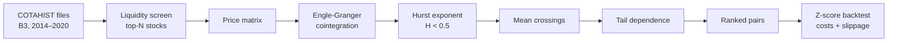

# Pair Trading on B3: a statistical arbitrage pipeline


An end-to-end research pipeline that screens the Brazilian stock market (B3) for **cointegrated pairs of stocks** and simulates a **market-neutral mean-reversion strategy** on them, using 7 years of official daily data (2014–2020).

Built by **Vitor Fujimoto**, **Diego Lopes** and **Guilherme Verissimo**, Statistics undergraduates at the Federal University of Paraná (UFPR), for the **Itaú Asset university Quant challenge**, where the project placed in the **Top 25 teams nationwide**.

🌐 **Project page:** https://fujimoto01.github.io/pair-trading/

---

## The idea in one paragraph

Two stocks exposed to the same economic drivers (two banks, two steelmakers) tend to move together. When the price gap between them, the *spread*, drifts unusually far from its historical level, a pairs trader sells the expensive one and buys the cheap one, betting that the gap will close. The hard part is statistical: telling apart pairs with a genuine long-run equilibrium from pairs that only looked correlated by chance. That is what this pipeline is about.

## Pipeline



| Stage | What it does | Why it matters |
|---|---|---|
| **1. Data** | Parses B3's fixed-width COTAHIST files; keeps common and preferred shares on the spot market (no ETFs, BDRs, units or REITs). | Official exchange data, not a third-party API. |
| **2. Liquidity** | Ranks stocks by a weighted score of traded volume, number of trades, trading frequency and consistency. | A pair is only tradable if both legs can be entered and exited at realistic prices. |
| **3. Cointegration** | Runs the Engle-Granger test on every pair of liquid stocks (~4,950 pairs for 100 stocks). | Correlation is not enough: cointegration means the spread is stationary and has an equilibrium to return to. |
| **4. Hurst exponent** | Keeps spreads with H < 0.5 (R/S method). | Confirms the spread is mean-reverting rather than trending or a random walk. |
| **5. Mean crossings** | Requires at least 12 crossings of the mean per year. | A spread that reverts once every two years is statistically valid but useless for trading. |
| **6. Tail dependence** | Estimates empirical lower and upper tail dependence. | Filters out pairs that crash together in market stress, when the hedge is needed most. |
| **7. Backtest** | Hedge ratio by OLS on the in-sample window (70%); trades the out-of-sample window (30%) on rolling z-score signals, with one-day execution delay, transaction costs, slippage and a z-score stop. | Separates estimation from evaluation and charges realistic frictions. |

## Results and ongoing validation

The pipeline consistently narrows the market down to a few dozen candidate pairs out of thousands of combinations. The first backtest run produced returns far too high to be credible, so we audited the backtester before publishing any performance number. The audit found issues that inflate results, which we are fixing:

- **Selection look-ahead.** Pairs are selected with statistics computed over the full 2014–2020 sample, which includes the out-of-sample trading window. Fix: select pairs using only data available before each trading window (walk-forward).
- **Portfolio aggregation.** Trades from 30 pairs, which overlap in time, are compounded one after another as if each one used the whole portfolio. Fix: mark the portfolio to market daily with a shared capital budget.
- **Metric annualization.** The annual return and Sharpe ratio treat each trade as one trading day. Fix: compute them from a daily equity curve.
- **Hedge leg sign.** The profit and loss of the second leg has its sign flipped, so the simulated position is not market neutral. Fix: correct the sign and add unit tests for each trade direction.

Corrected, out-of-sample results will be published here once the walk-forward backtest is in place. We think this audit is as important as the pipeline itself: in quantitative finance, a backtest that looks too good usually is.

## Quick start

```bash
pip install -r requirements.txt
```

Download the yearly `COTAHIST_AYYYY.ZIP` files from B3's historical quotes page, extract them into `data/`, then run:

```bash
python run_pipeline.py --anos 2014-2020
```

```bash
python portfolio_backtest.py --anos 2014-2020 --n-pares 30
```

All parameters (liquidity weights, p-value threshold, Hurst cut-off, z-score entry and exit, costs, train/test split) live in [`config/config.yaml`](config/config.yaml). The notebook [`pair_trading_analysis.ipynb`](pair_trading_analysis.ipynb) runs the same pipeline step by step with interactive widgets.

## Project structure

```
pair-trading/
├── src/
│   ├── collection/     # COTAHIST parsing and liquidity scoring
│   ├── preparation/    # price matrix
│   ├── analysis/       # cointegration, Hurst, mean crossings, tail dependence
│   ├── backtesting/    # pair and portfolio backtesters
│   ├── pipeline/       # orchestrates all stages, with caching
│   └── utils/          # configuration and logging
├── config/config.yaml  # every tunable parameter
├── run_pipeline.py     # CLI: full selection pipeline
├── portfolio_backtest.py
├── pair_trading_analysis.ipynb
└── site/               # project page (GitHub Pages)
```

## Tech stack

Python · pandas · NumPy · SciPy · statsmodels · PyYAML · Jupyter

---

<details>
<summary><b>🇧🇷 Resumo em português</b></summary>

<br>

Pipeline de pesquisa que seleciona pares de ações cointegradas na B3 e simula uma estratégia de retorno à média neutra ao mercado, com dados oficiais COTAHIST de 2014 a 2020. Etapas: filtro de liquidez, teste de cointegração de Engle-Granger, expoente de Hurst, cruzamentos da média, dependência de cauda e backtest com custos, derrapagem e separação dentro e fora da amostra.

Projeto de Vitor Fujimoto, Diego Lopes e Guilherme Verissimo, estudantes de Estatística da UFPR, feito para o desafio universitário Quant da Itaú Asset, em que ficou entre as 25 melhores equipes do país.

Os primeiros resultados do backtest saíram bons demais para serem verdade, então auditamos o código antes de divulgar números. A auditoria encontrou viés de seleção, agregação incorreta da carteira, anualização das métricas por trade e um erro de sinal na segunda perna. Os resultados corrigidos serão publicados aqui.

</details>
