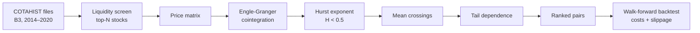

# Pair Trading on B3: a statistical arbitrage pipeline


An end-to-end research pipeline that screens the Brazilian stock market (B3) for **cointegrated pairs of stocks** and simulates a **market-neutral mean-reversion strategy** on them, using 7 years of official daily data (2014–2020).

Built by **Vitor Fujimoto**, **Diego Lopes** and **Guilherme Verissimo**, Statistics undergraduates at the Federal University of Paraná (UFPR), for the **Itaú Asset university Quant challenge**, where the project placed in the **Top 25 teams nationwide**.

🌐 **Project page:** https://fujimoto01.github.io/pair-trading/

---

## The idea in one paragraph

Two stocks exposed to the same economic drivers (two banks, two steelmakers) tend to move together. When the price gap between them, the *spread*, drifts unusually far from its historical level, a pairs trader sells the expensive one and buys the cheap one, betting that the gap will close. The hard part is statistical: telling apart pairs with a genuine long-run equilibrium from pairs that only looked correlated by chance. That is what this pipeline is about.

## Pipeline



| Stage | What it does | Why it matters |
|---|---|---|
| **1. Data** | Parses B3's fixed-width COTAHIST files; keeps common and preferred shares on the spot market (no ETFs, BDRs, units or REITs). | Official exchange data, not a third-party API. |
| **2. Liquidity** | Keeps the 100 stocks with the highest average daily traded value. | A pair is only tradable if both legs can be entered and exited at realistic prices. |
| **3. Cointegration** | Runs the Engle-Granger test on every pair of liquid stocks (~4,950 pairs for 100 stocks). | Correlation is not enough: cointegration means the spread is stationary and has an equilibrium to return to. |
| **4. Hurst exponent** | Keeps spreads with H < 0.5 (R/S method). | Confirms the spread is mean-reverting rather than trending or a random walk. |
| **5. Mean crossings** | Requires at least 12 crossings of the mean per year. | A spread that reverts once every two years is statistically valid but useless for trading. |
| **6. Tail dependence** | Estimates empirical lower and upper tail dependence and keeps pairs above a minimum. | Keeps pairs whose two stocks also move together on extreme days, when the hedge is needed most. |
| **7. Backtest** | Walk-forward: selection and hedge ratio on the two previous years, trading on the next six months with rolling z-score signals, one-day execution delay, transaction costs and slippage. | No decision uses data from the future, and frictions are charged. |

## Results

The backtest is walk-forward: pairs are selected on the two previous years of data and traded for the next six months, then everything rolls six months ahead. That gives 10 rounds, all out of sample, from January 2016 to December 2020. Each pair gets 1/30 of the capital, orders are executed at the next day's close, each order pays 0.15% in fees and slippage, and the portfolio is marked to market every day.

| | Strategy | BOVA11 (for scale) |
|---|---|---|
| Annual return | +2.6% | +25.8% |
| Annual volatility | 4.6% | 28.0% |
| Sharpe ratio (risk-free rate = 0) | 0.58 | 0.96 |
| Worst drawdown | −5.8% | −46.9% |
| Trades | 265 (62% profitable) | |
| Correlation with BOVA11 | 0.24 | |

A small, steady and nearly market-neutral result, below what Brazilian fixed income paid in the period. About 36% of the capital was in use on an average day, and only 48% of the trades closed because the spread reverted; the rest were still open when their round ended, at a loss on average. Many selected pairs have no economic link, which suggests restricting candidates to the same industry as the next step. Charts and details are on the [project page](https://fujimoto01.github.io/pair-trading/).

### Backtest audit

The backtest written during the challenge produced returns far too high to be credible, so we audited it before publishing any number. It had four errors, all fixed in `src/backtesting/walk_forward.py`:

- **Selection look-ahead.** Pairs were selected with statistics from the full 2014–2020 sample, which includes the period traded. Now each round only uses the two years before it.
- **Portfolio aggregation.** Overlapping trades from different pairs were compounded one after another, as if each used the whole capital. Now each pair has a fixed slice and the portfolio is valued daily.
- **Metric annualization.** Annual return and Sharpe ratio treated each trade as one trading day. Now they come from the daily equity curve.
- **Hedge leg sign.** The profit of the second leg had its sign flipped, so the simulated position was not hedged. Now both legs are plain share positions, with unit tests for each direction.

Running the corrected engine with pairs chosen on the full sample, as the first version did, gives +6.9% per year and a Sharpe ratio of 1.22. Look-ahead in the selection alone more than doubles the result.

The first backtester (`backtest.py`, `portfolio_backtest.py`, `src/backtesting/backtester.py`, `src/backtesting/portfolio_backtester.py`) is kept for reference only.

### Known limitations

- COTAHIST prices are raw. Splits are detected by a rule (one-day price ratio below 0.6 or above 1.7) and corrected; dividends and small bonus issues are not.
- No stock loan fee for short positions, and idle cash earns nothing.
- Parameters are those of the original project and were not tuned on these results.
- Five years and 265 trades are a small sample.

## Quick start

```bash
pip install -r requirements.txt
```

Download the yearly `COTAHIST_AYYYY.ZIP` files from B3's historical quotes page into `data/` (no need to extract them), then run:

```bash
python run_walkforward.py
```

It writes the daily equity curve, the trades and the selected pairs to `outputs/08_walk_forward/`, and the data behind the project page to `site/data.js`. It takes about 10 minutes, most of it in the 49,500 cointegration tests.

```bash
python -m pytest tests
```

The original selection pipeline, on the whole sample, still runs with `python run_pipeline.py --anos 2014-2020` (it expects the extracted `.TXT` files). Its parameters live in [`config/config.yaml`](config/config.yaml), and the notebook [`pair_trading_analysis.ipynb`](pair_trading_analysis.ipynb) runs it step by step.

## Project structure

```
pair-trading/
├── src/
│   ├── collection/     # COTAHIST parsing and liquidity scoring
│   ├── preparation/    # price matrix
│   ├── analysis/       # cointegration, Hurst, mean crossings, tail dependence
│   ├── backtesting/    # walk_forward.py (current) and the first backtesters
│   ├── pipeline/       # orchestrates all stages, with caching
│   └── utils/          # configuration and logging
├── config/config.yaml  # every tunable parameter
├── run_walkforward.py  # CLI: walk-forward backtest and page data
├── run_pipeline.py     # CLI: original selection pipeline
├── tests/              # trade mechanics
├── pair_trading_analysis.ipynb
├── index.html          # project page (GitHub Pages)
└── site/               # page styles, charts and data
```

## Tech stack

Python · pandas · NumPy · SciPy · statsmodels · PyYAML · Jupyter

---

<details>
<summary><b>🇧🇷 Resumo em português</b></summary>

<br>

Pipeline de pesquisa que seleciona pares de ações cointegradas na B3 e simula uma estratégia de retorno à média neutra ao mercado, com dados oficiais COTAHIST de 2014 a 2020. Etapas: filtro de liquidez, teste de cointegração de Engle-Granger, expoente de Hurst, cruzamentos da média, dependência de cauda e backtest walk-forward com custos e derrapagem.

Projeto de Vitor Fujimoto, Diego Lopes e Guilherme Verissimo, estudantes de Estatística da UFPR, feito para o desafio universitário Quant da Itaú Asset, em que ficou entre as 25 melhores equipes do país.

Os primeiros resultados do backtest saíram bons demais para serem verdade, então auditamos o código antes de divulgar números. A auditoria encontrou viés de seleção, agregação incorreta da carteira, anualização das métricas por trade e um erro de sinal na segunda perna, todos corrigidos. No teste walk-forward, fora da amostra (2016 a 2020), a carteira rendeu 2,6% ao ano, com volatilidade de 4,6%, Sharpe de 0,58 e queda máxima de 5,8%. Com os pares escolhidos usando a amostra inteira, como na primeira versão, o mesmo motor daria 6,9% ao ano.

</details>
